# web-checkout

Self-service checkout for a snack bar. A customer walks up to a tablet mounted at the counter, browses the menu, builds an order, pays and walks away, with no cashier to ask for help.

## Documentation

- [Requirements](./docs/requirements.md): functional, non-functional and constraints.
- [Architecture](./docs/architecture.md): containers, the checkout and payment flow, lifecycles and the data model.
- [Glossary](./GLOSSARY.md): the vocabulary used across code and docs.
- [Architecture decisions](#architecture-decisions): the ADRs, listed below.
- [Walkthrough](#walkthrough): the kiosk, Demo tools, Swagger and metrics, success and failure.

## Run it

Needs Docker and Node 24. From a Unix machine (or Windows with Docker Desktop):

```bash
docker compose up --build
```

Then open [http://localhost:8080](http://localhost:8080). The API is on port 3000 (`/health`, `/docs` for Swagger UI; staff calls take `X-Staff-Key: dev-staff-key`). The payment mock is on port 4000.

Compose sets `ALLOW_FORCE_ERROR=true`, so a card outcome can be forced even though the API image runs with `NODE_ENV=production`. On the card screen, **Demo tools** adds the `X-Force-Error` header to the payment request (`declined` or `timeout`). The API forwards that header only when the flag is on. Leave the flag unset in a real deployment and the header is ignored.

Starting the API migrates the database and, when the menu tables are empty, fills them. `npm run db:seed` in `apps/api` does that same fill without leaving a server running. A database that already has categories is left alone.

```bash
make lint          # oxlint, from the repo root (`npm ci` once, so the linter is installed)
make test          # payment-mock, API (Postgres via Testcontainers), kiosk unit/UI tests, and Playwright
make typecheck
docker compose --profile observability up --build   # Prometheus :9090 and Grafana :3001
```

GitHub Actions runs lint, typecheck and the same tests on every push and pull request. Prometheus loads `observability/alerts.yml`: API P95 above 300 ms, API P99 above 1 s (the payment route is excluded, because it includes provider time), provider P99 above the 3 s timeout, card attempts failing more than a quarter of the time, and any refund that exhausted its retries.

Playwright (`npm run e2e` in `apps/web`) needs Docker and a one-time `npx playwright install chromium` in that app. It boots its own Postgres, API, payment mock and kiosk, then pays at the counter, recovers a declined card by paying at pickup, and pays by card. Grafana's Prometheus datasource uid is `prometheus`, and Prometheus scrapes the API on the host's port 3000.

Without Compose, start Postgres (`docker compose up -d postgres`), then `node src/server.ts` in `apps/payment-mock` and `apps/api`, and `npm run dev` in `apps/web`. The dev kiosk is [http://localhost:5173](http://localhost:5173) (the same site on `127.0.0.1` is allowed). If port 4000 is already taken, start the mock with `PORT` set to a free port and point the API at it with `PAYMENT_PROVIDER_URL`.

## Walkthrough

Use this after `docker compose up --build`. The kiosk is [http://localhost:8080](http://localhost:8080). On the dev server the same clicks happen at [http://localhost:5173](http://localhost:5173). The API is [http://localhost:3000](http://localhost:3000).

Set **Demo tools** back to **As the provider decides** between sections, or the next card payment stays forced.

### 1. Menu, cart and a counter payment

1. Open the kiosk. The first screen is Snack Counter, **Start your order**.

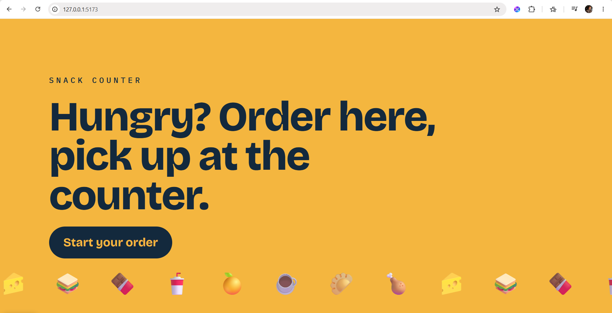

2. Start the order. Products are grouped into Snacks, Sweets and Drinks. Carrot cake is sold out, greyed out, and last in Sweets. Beef empanada and Brownie show how many are left, because the seed gives them 5 or fewer.

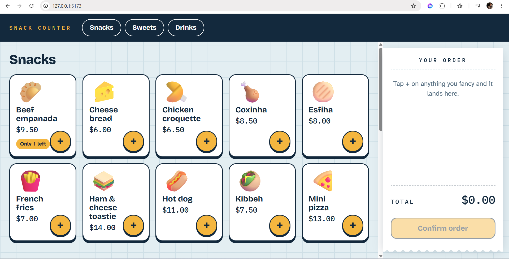

3. Add a Water. The ticket on the side shows the line and the total. **+** and **−** change the quantity. The add button stops at the stock the menu reported.

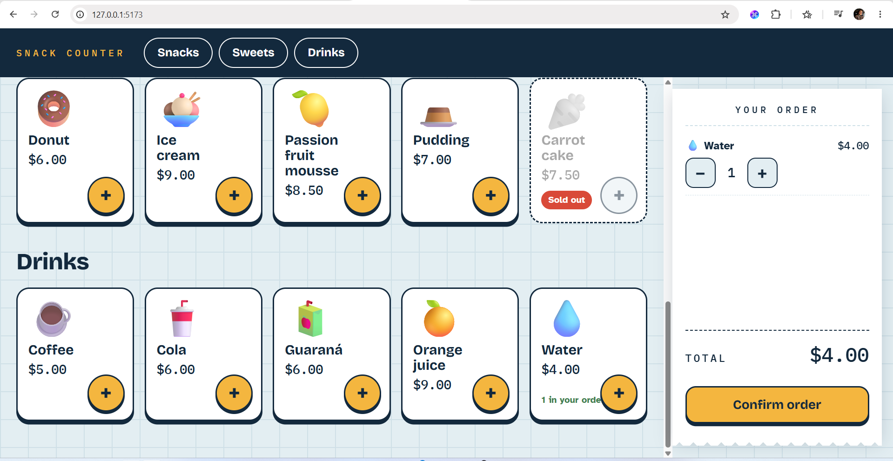

4. **Confirm order**. The next screen is **How would you like to pay?** with the total, **Card**, **Pay at pickup** and **Cancel**.

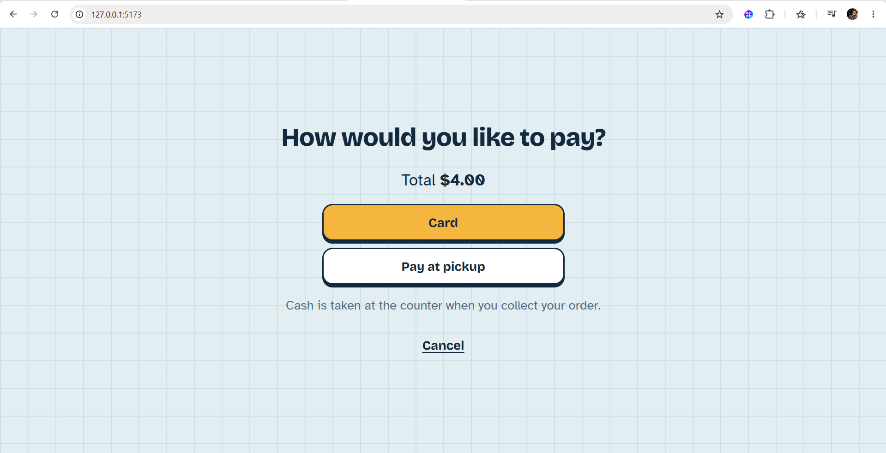

5. **Pay at pickup**. The receipt shows a short code (such as `A-001`), the line, and the amount to pay at the counter. **Done** returns to the start. Leaving the receipt alone does the same after about 15 seconds.

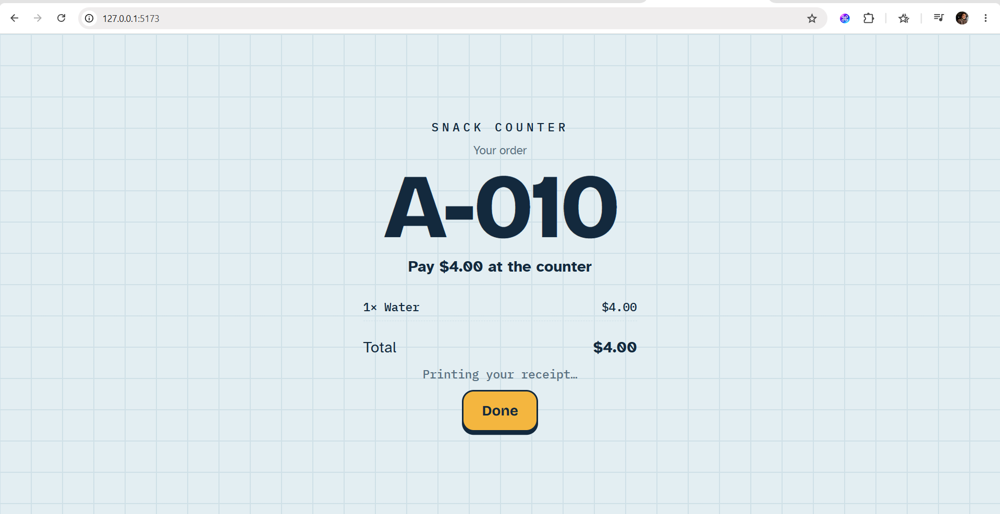

### 2. Card payment, cancel, and a decline from the screen

1. Order a Water again and confirm. Choose **Card**. The reader says **Tap your card**, with **Cancel** and a collapsed **Demo tools**.

2. **Cancel** here goes back to the payment choice. The reservation stays. **Cancel** on the payment choice drops the order and returns the unit to stock, then the start screen.

3. Choose **Card** again and tap the card, with Demo tools still closed. The receipt says **Paid by card**.

4. From the receipt, press **Done** (or wait about 15 seconds) until **Start your order** is back. Add a Water, **Confirm order**, then **Card**. You are on the reader: a dark pad, **Tap your card**, and under it a quiet **Cancel**. Below Cancel, the words **Demo tools** are a disclosure, not a payment button. Click **Demo tools**. A dropdown labeled **Force card outcome** opens. Change it from **As the provider decides** to **Declined**. That choice adds the header `X-Force-Error: declined` to the payment request the kiosk sends.

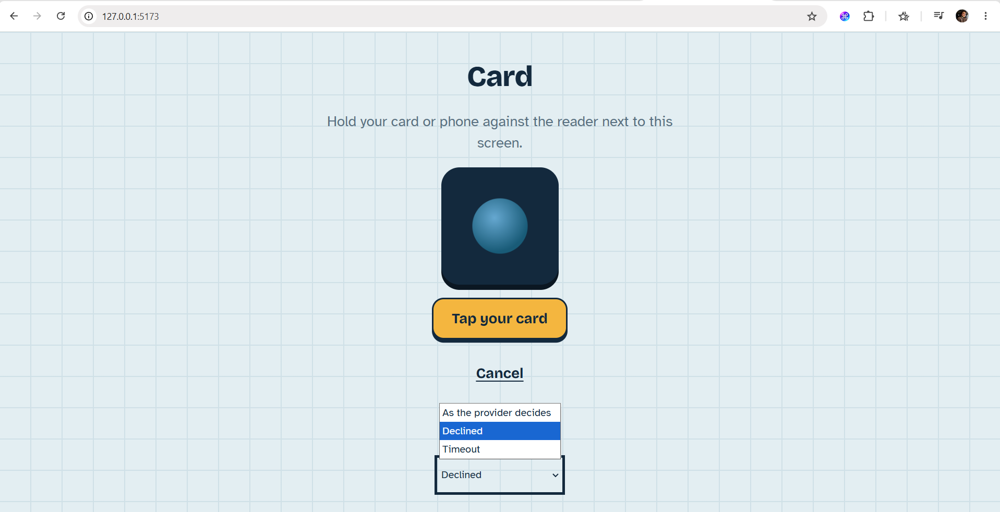

Only then press **Tap your card**. The next screen is **Your card was declined**, with **Try another card**, **Pay at pickup** and **Cancel**. If you tap the card before changing the dropdown, no header is sent and the payment is a normal approval. In DevTools, the `POST /checkouts/.../payment` request shows the header, and the `402` body is the decline.

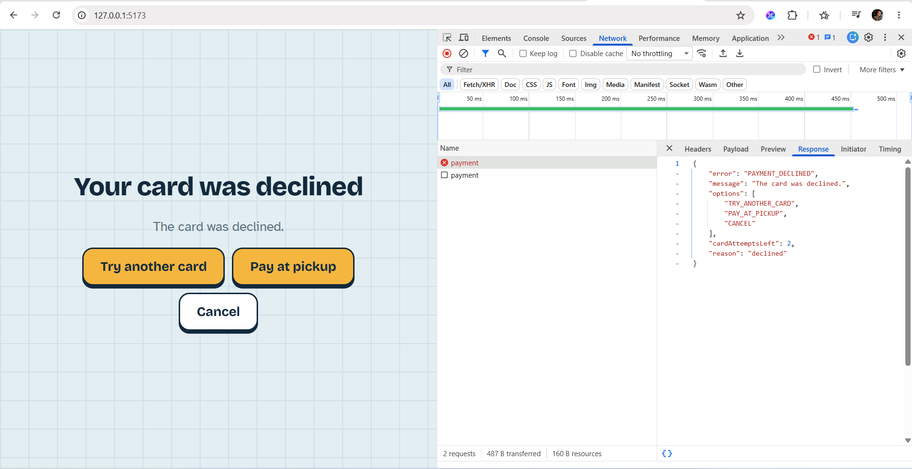

5. **Pay at pickup**. The receipt is for the counter, the same shape as section 1.

6. One more order. On the reader, set Demo tools to **Timeout**. That adds `X-Force-Error: timeout` to the payment request. Tap the card. The button stays on **Processing…** for several seconds. The next screen is **Couldn't confirm your card payment**: try another card is gone, and the copy says a charge would be refunded. **Pay at pickup** or **Cancel**.

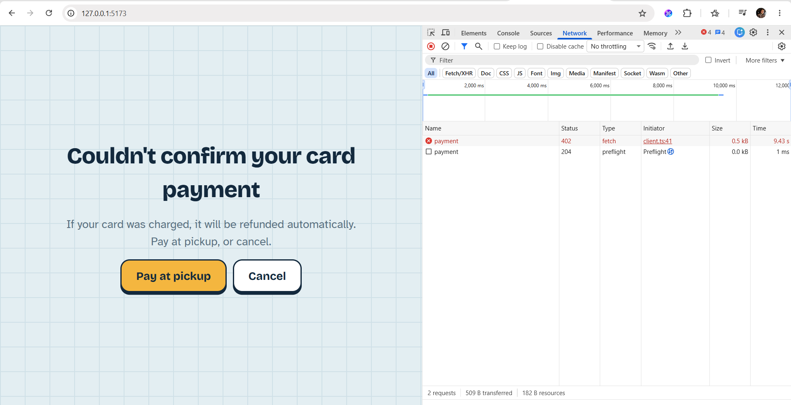

### 3. Two kiosks and the last units

Beef empanada starts with 4 units. If this database already served orders, use whichever snack the menu still marks as the last few, and add that many in both windows.

1. Open the kiosk in two windows. In both, add Beef empanada until **+** disables.
2. In the first window, confirm and choose **Pay at pickup**. That window gets a receipt.
3. In the second window, confirm. The screen is **Your order changed**: the empanada is sold out and removed. **Continue with these changes** confirms what is left (nothing, so it sends you back to add something else). **Edit order** returns to the menu with the sold-out line already dropped.

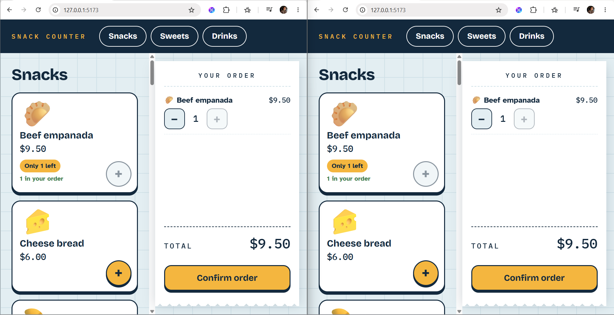

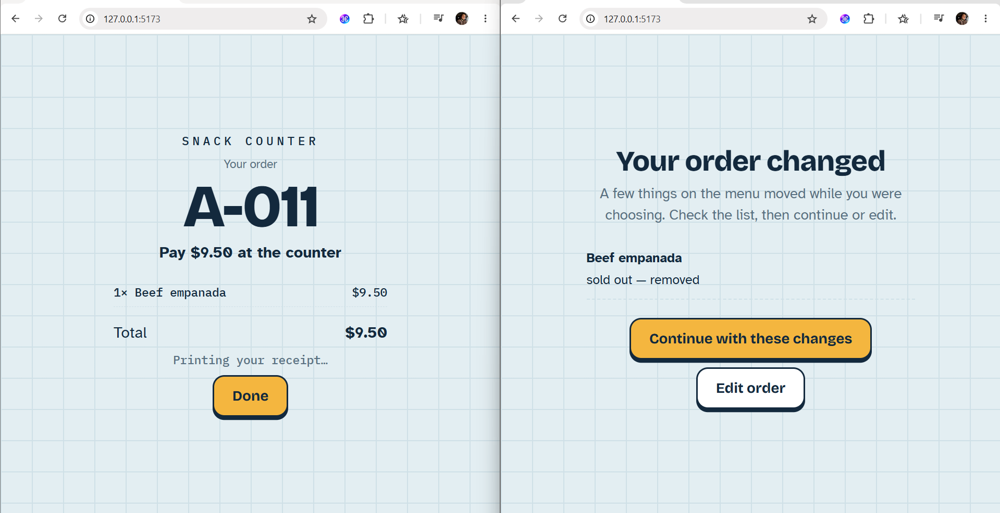

### 4. Someone walks away

1. Start an order and stop touching the screen.
2. After about 60 seconds the dialog is **Still there?** with a 15 second countdown.
3. **I'm still here** keeps the cart. If the countdown ends, the kiosk returns to the start and releases a checkout that was still open.

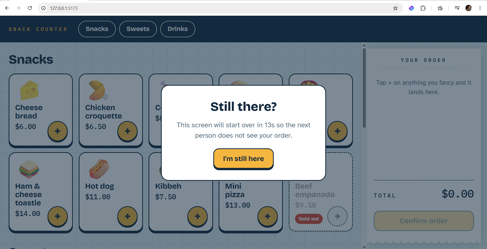

### 5. Swagger

Open [http://localhost:3000/docs](http://localhost:3000/docs).

1. **Authorize**. The scheme is `staffKey`. The value for this Compose stack is `dev-staff-key`. That sends `X-Staff-Key` on the staff calls. **Authorize**, then **Close**.

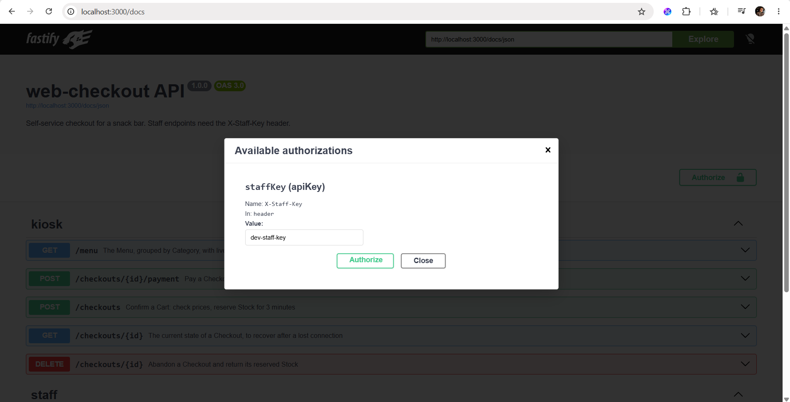

2. `GET /menu` needs no key. **Try it out**, **Execute**. The `200` body is the same menu as the kiosk, with ids you will paste below.

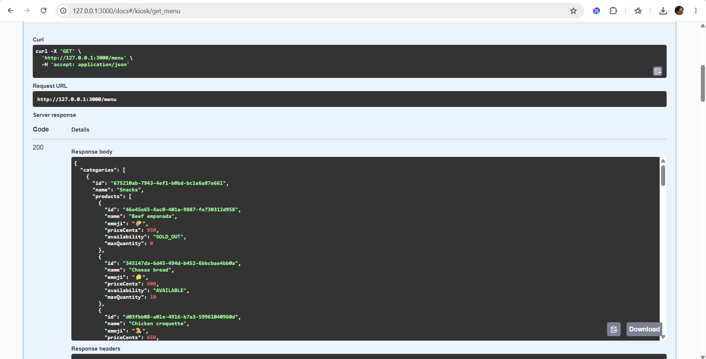

3. `POST /checkouts`. **Try it out**. Header `idempotency-key`: any UUID v4 (eg: 6a307fbb-795d-4102-8ab4-cc6740ef8ce7). Body, using a product id and `priceCents` from the menu response (Water is `400`):

```json
{
  "items": [
    { "productId": "<water id>", "quantity": 1, "unitPriceCents": 400 }
  ]
}
```

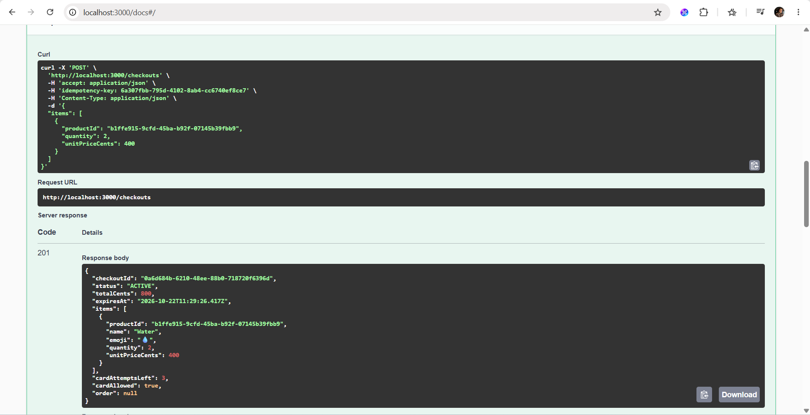

4. Copy `checkoutId`. `POST /checkouts/{id}/payment`. Header `idempotency-key`: a new UUID (eg da58044d-702b-414a-8613-0933954b8df8). Body:

```json
{ "method": "PAY_AT_PICKUP" }
```

`201` is the order: `status` `PAYMENT_PENDING`, `paymentMethod` `PAY_AT_PICKUP`, and a `code`. A `CARD` body with header `x-force-error: declined` returns `402` instead. That is the same header **Demo tools** adds when the dropdown is set to **Declined**.

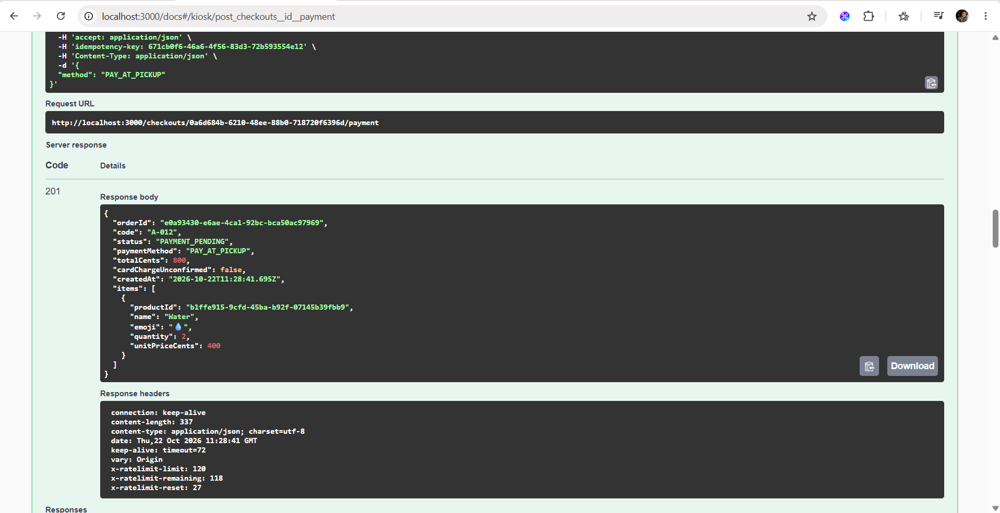

5. `GET /checkouts/{id}` returns that checkout with `order` filled in. `DELETE /checkouts/{id}` on a checkout that is already an order returns `409`. To see a release, create a second checkout and `DELETE` it while it is still `ACTIVE`: `200`, status `RELEASED`.

6. `GET /orders`. Leave `status` empty for the recent list, or set `PAYMENT_PENDING`. The order from step 4 is there.

7. Copy `orderId`. `POST /orders/{id}/mark-paid`. **Execute**. `200`, status `PAID`.

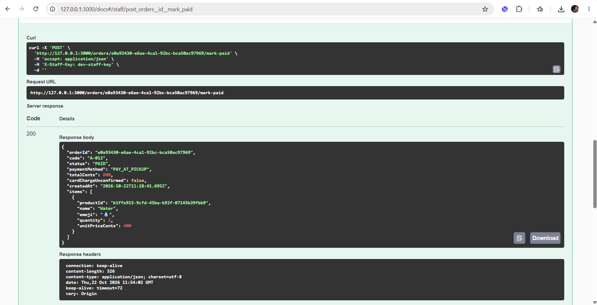

Then `POST /orders/{id}/pick-up`. `200`, status `PICKED_UP`.

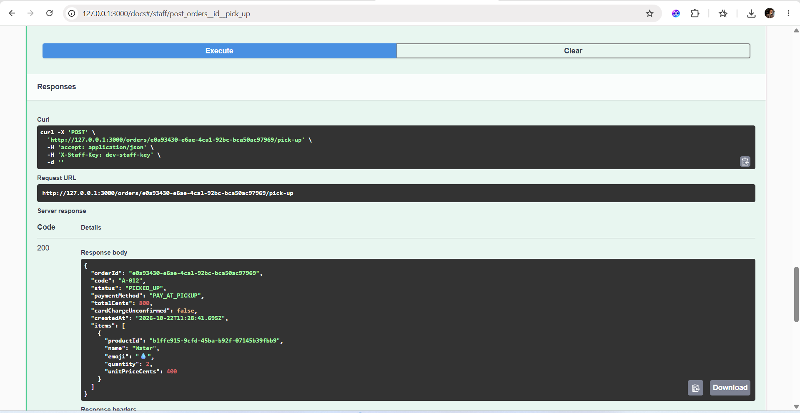

8. Place another Pay at pickup order. `POST /orders/{id}/cancel`. `200`, status `CANCELLED`. Its units go back to stock. Cancelling one that was **Paid by card** also asks the mock to refund that charge. `POST /orders/{id}/pick-up` on an order that is still `PAYMENT_PENDING` returns `409`: it has to be marked paid first.

9. **Authorize** again and **Logout**, so the key is not sent. `GET /orders` returns `401` and `STAFF_KEY_REQUIRED`. Put `dev-staff-key` back before the next staff call.

`GET /health` returns `{ "status": "ok" }` with no key.

### 6. Metrics

1. Open [http://localhost:3000/metrics](http://localhost:3000/metrics) to see the Raw Metrics. After the orders above, the text includes `http_request_duration_seconds`, `payment_provider_request_duration_seconds`, `orders_placed_total`, `payment_attempts_total` and `refunds_failed_total`.

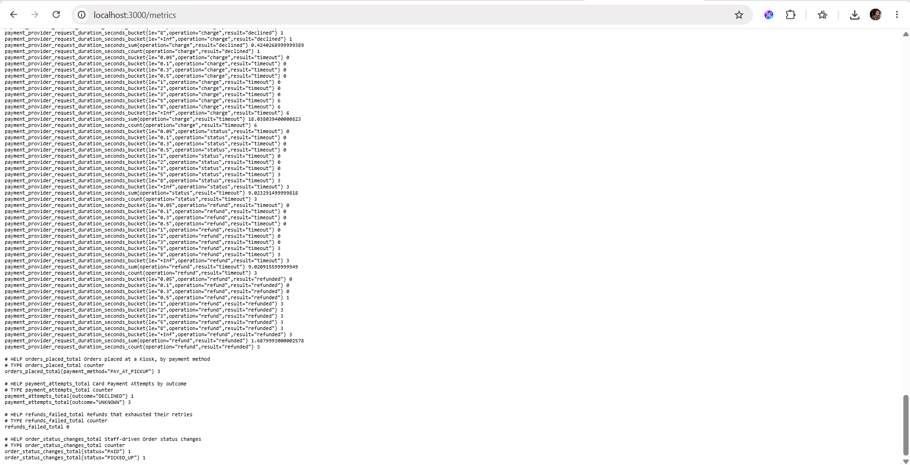

2. With the observability profile up (`docker compose --profile observability up --build`), Prometheus is [http://localhost:9090](http://localhost:9090). **Alerts** lists `ApiLatencyP95High`, `ApiLatencyP99High`, `ProviderLatencyP99High`, `PaymentFailureRateHigh` and `RefundsFailed`. A query such as `orders_placed_total` shows the counter.

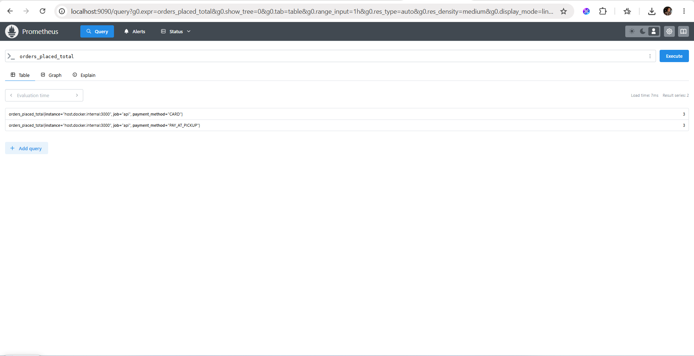

3. Grafana is [http://localhost:3001](http://localhost:3001). Anonymous viewers can open the **Web checkout** dashboard (API P95, provider P95, orders placed). To administer, sign in as `admin` / `admin`.

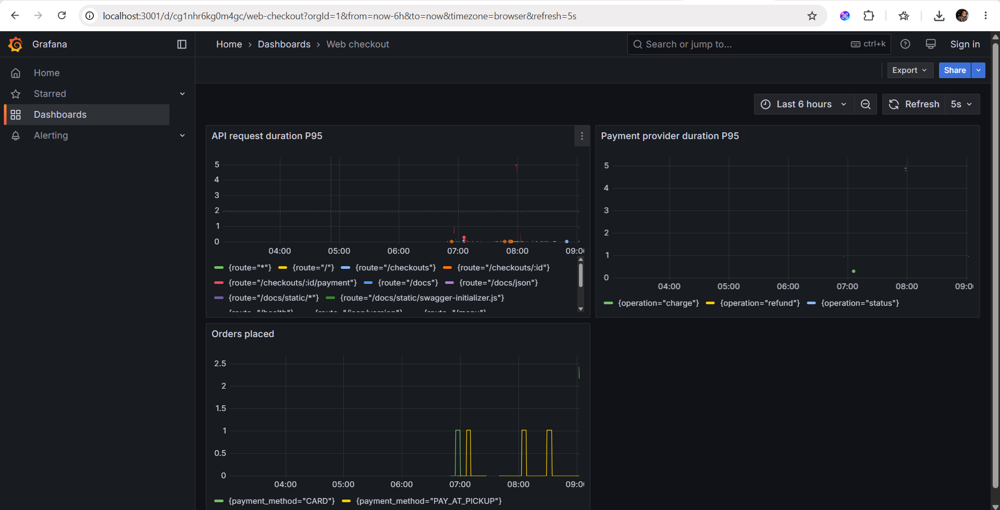

## How this was built

Design came before code. A Cursor agent questioned the first draft through every branch of the decision tree, using the skills versioned in [`.cursor/skills`](./.cursor/skills/), and the glossary and ADRs were written as each decision was settled. The [session record](./docs/process/0001-architecture-grilling.md) shows what the agent found, and where the human overrode it. Later steps are recorded in [`docs/process`](./docs/process/).

## Agent skills

[`.cursor/skills`](./.cursor/skills/) holds the three skills that drove that design session. Each name ends in `-lucaohost` because it is a fork of a skill from [Matthew Pocock's skills](https://github.com/mattpocock/skills):

- [`grilling-lucaohost`](./.cursor/skills/grilling-lucaohost/SKILL.md) stress-tests a plan as a decision tree before anyone acts on it.
- [`domain-modeling-lucaohost`](./.cursor/skills/domain-modeling-lucaohost/SKILL.md) sharpens terminology and writes the glossary and ADRs as decisions settle.
- [`grill-with-docs-lucaohost`](./.cursor/skills/grill-with-docs-lucaohost/SKILL.md) runs the other two together, in Portuguese, and leaves the docs in the repo.

## Scope

The time budget goes, in order, to:

1. **A robust core flow**: menu, cart, payment and order, including what happens when payment, stock or the network misbehave, and a kiosk-friendly experience for someone alone at the screen.
2. **A visible process**: how the project went from an empty folder to a finished thing.
3. **Observability**: structured logs and latency metrics always on; Prometheus, Grafana and alerts as an opt-in extra.

### Service level objectives

- API processing, excluding the payment provider: P95 under 300 ms.
- Payment provider call: 3 s timeout.
- Worst case the Customer waits, including one automatic retry and a status check: about 7 to 8 s, with visual feedback the whole time.

### Out of scope, and future improvements

- **Offline mode.** The kiosk shows a friendly error and retries when the network drops; ordering offline (PWA, service worker) is not built, since payment needs the network anyway.
- **Product customization and upsell**: sizes, extras, "no onions", suggestions at checkout.
- **Internationalization.** The UI is in English, with its texts kept in one place so a translation can be added.
- **Admin screen.** Products, categories and stock come from a seed script.
- **Counter screen for staff** to follow Orders and move them between statuses; until then, staff use the API through Swagger UI ([ADR-0013](./docs/adr/0013-order-lifecycle-staff-endpoints.md)).
- **Waste tracking.** Cancelling an Order returns its units to Stock, which assumes ready-made Products; prepared-to-order Products should be recorded as waste instead.
- **Automatic cancellation of unpaid Pay at Pickup Orders**, once the snack bar defines how long to wait.
- **Authentication**: per-kiosk credentials and per-person staff accounts instead of a shared staff key ([ADR-0008](./docs/adr/0008-kiosk-security-baseline.md)).
- **Redis for the Menu cache**, once there are several API instances ([ADR-0011](./docs/adr/0011-menu-cache-in-memory.md)).

## Architecture decisions

- [0001: Frontend in React with TypeScript](./docs/adr/0001-frontend-react-typescript.md)
- [0002: Backend in Node.js with TypeScript](./docs/adr/0002-node-typescript-backend.md)
- [0003: Fastify as the HTTP framework](./docs/adr/0003-fastify-http-framework.md)
- [0004: PostgreSQL as the database](./docs/adr/0004-postgres-database.md)
- [0005: Drizzle for data access](./docs/adr/0005-drizzle-data-access.md)
- [0006: Payment mock as a separate service](./docs/adr/0006-payment-mock-separate-service.md)
- [0007: One repository, three independent apps, an OpenAPI contract](./docs/adr/0007-monorepo-openapi-contract.md)
- [0008: Kiosk security baseline: no authentication for Customers, a shared key for staff](./docs/adr/0008-kiosk-security-baseline.md)
- [0009: Idempotency keys on state-changing kiosk requests](./docs/adr/0009-idempotency-keys.md)
- [0010: Stock is reserved when the Checkout starts](./docs/adr/0010-stock-reservation.md)
- [0011: Menu cached in API memory, Stock never cached](./docs/adr/0011-menu-cache-in-memory.md)
- [0012: Card payment: one automatic retry, unknown outcomes and Refunds](./docs/adr/0012-card-payment-retry-unknown-refund.md)
- [0013: Order lifecycle driven by staff endpoints, without a screen](./docs/adr/0013-order-lifecycle-staff-endpoints.md)
