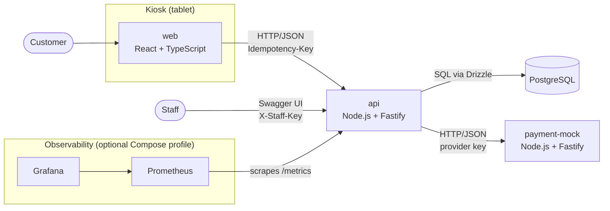
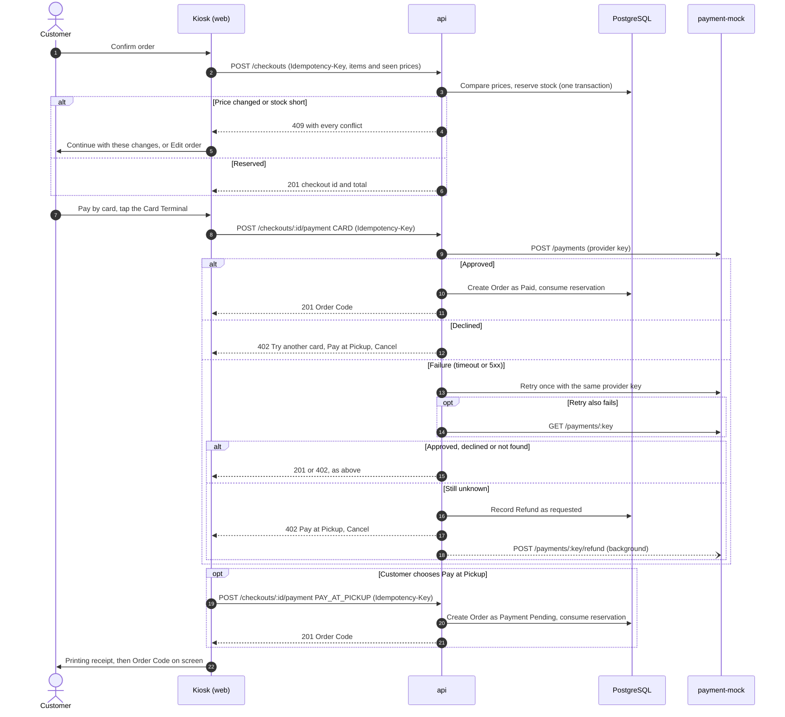
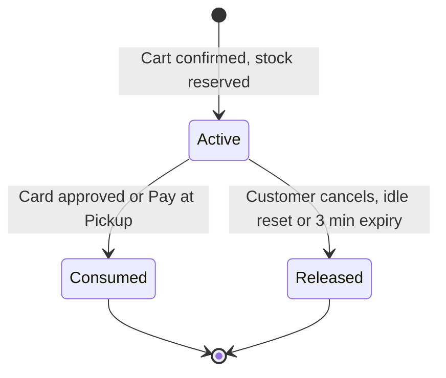
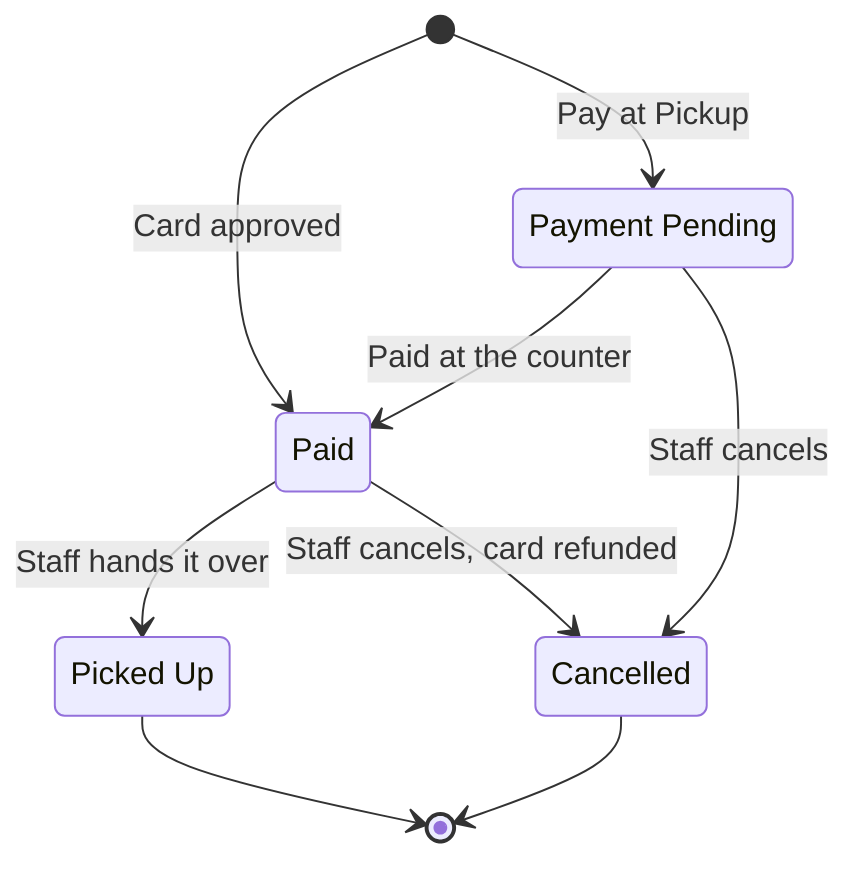
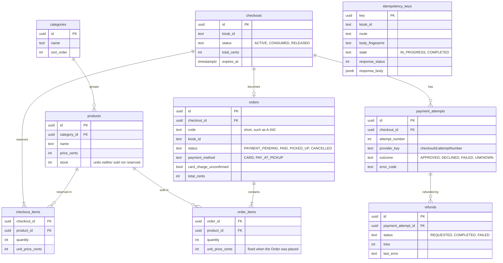

# Architecture

Four views of the system. The reasoning behind each choice lives in the [ADRs](./adr/), and the vocabulary in the [glossary](../GLOSSARY.md).

## Containers

`web`, `api` and `payment-mock` run on separate ports and share no code; the frontend's API types are generated from the API's OpenAPI document ([ADR-0007](./adr/0007-monorepo-openapi-contract.md)).

## Checkout and payment

Details: [ADR-0009](./adr/0009-idempotency-keys.md) (keys), [ADR-0010](./adr/0010-stock-reservation.md) (reservation and conflicts), [ADR-0012](./adr/0012-card-payment-retry-unknown-refund.md) (retry, unknown outcomes and Refunds).

## Lifecycles

A Checkout holds the Stock Reservation until it becomes an Order or is abandoned:

An Order moves after the Customer has left the Kiosk, through staff endpoints ([ADR-0013](./adr/0013-order-lifecycle-staff-endpoints.md)):

## Data model

Conceptual; column names may change during implementation.

